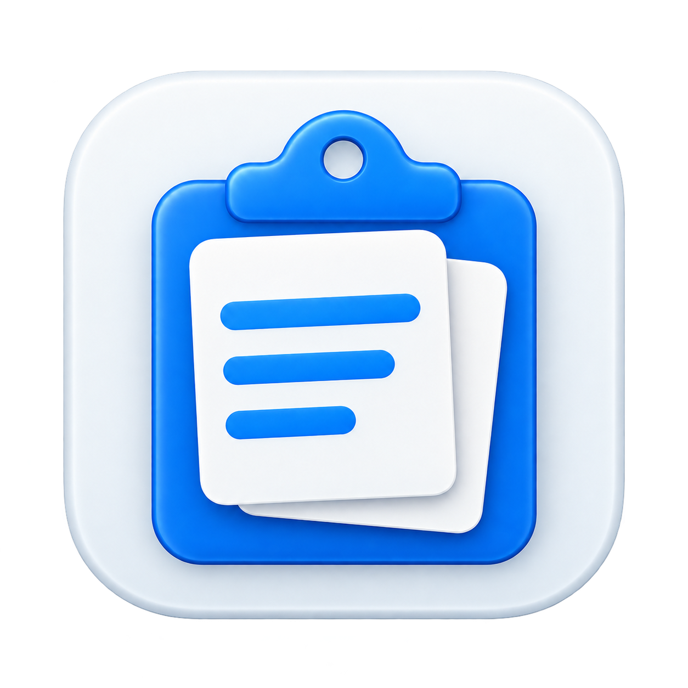
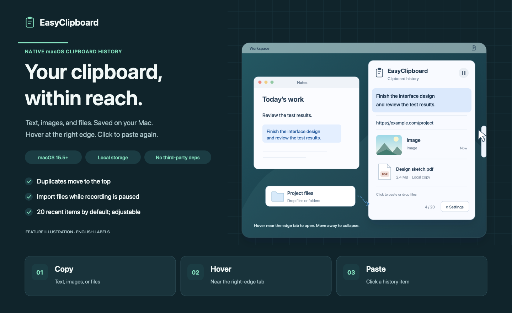

<div align="center">
  
  <h1>EasyClipboard</h1>
  <p><strong>English</strong> · <a href="README.zh-CN.md">简体中文</a></p>
  <p><strong>Your clipboard, within reach.</strong></p>
  <p>A lightweight native macOS clipboard manager for text, images, and files.</p>
  <p>macOS 15.5+ · SwiftUI + AppKit · Local storage · No third-party dependencies</p>
</div>



*Feature illustration with English labels. The app currently uses Chinese interface text and a light panel appearance.*

## Features

- **Text, images, and files.** Keep recently copied content in one history; copying the same content again moves it to the top.
- **Open from the screen edge.** Hover near the clipboard tab at the middle of the right edge to open the panel. It stays centered, fits shorter histories, and scrolls within a maximum height of 480 points. Moving away collapses it after a brief delay.
- **Click to paste.** The floating panel preserves the target app's input focus. With Accessibility permission, selecting an item restores it to the clipboard and sends **⌘V** to that app.
- **Readable text previews.** Text rows show the original content without extra icons or metadata. They grow to fit, preview up to 6 lines, and paste the complete original text.
- **Drag in files and folders.** Add one or multiple files or folders directly to the panel, even while automatic recording is paused.
- **Control your history.** Keep the latest 20 items by default, change the limit, pause or resume recording, delete individual items, or clear everything.
- **Restore after relaunch.** History and attachments are saved locally with Core Data and managed attachment storage.

## Build and run

Requires **macOS 15.5 or later** and **Xcode 16.4 or later**.

```sh
git clone https://github.com/jackma5477001/EasyClipboard.git
cd EasyClipboard
open EasyClipboard.xcodeproj
```

Select the **EasyClipboard** scheme and **My Mac** destination in Xcode, then run with **⌘R**. The app lives in the menu bar; use the clipboard icon to open history, pause recording, open settings, or quit.

## Use it

1. Copy text, an image, or files with **⌘C**.
2. Place the cursor where you want to paste in the target app.
3. Move the pointer near the clipboard tab at the middle of the right screen edge.
4. Click a history item to restore and paste it.

For automatic pasting, enable EasyClipboard in **System Settings → Privacy & Security → Accessibility**. You can also request access from the menu bar. Without permission, the selected content is still restored to the clipboard; press **⌘V** manually. If the active app changes before pasting, EasyClipboard also falls back to manual paste.

To add files manually, drag them from Finder into the panel. Importing alone does not change the system clipboard; selecting the imported item restores its files for pasting.

Hover over an item to reveal its delete button, or use its context menu. Open the gear button to change the history limit to a positive integer or clear history. Lowering the limit immediately removes the oldest excess entries. Content copied while recording is paused is skipped and is not added when recording resumes.

## Storage rules

History and attachments are stored under:

```text
~/Library/Application Support/EasyClipboard/
├── History.sqlite
└── Attachments/
```

| Content | How it is stored |
| --- | --- |
| Text | Full original text, including whitespace |
| Images | Local PNG or TIFF data |
| Regular files smaller than **10 MiB** each | A local copy; if copying fails, the original location is retained |
| Files **10 MiB or larger**, folders, and symbolic links | A reference to the original location |

Moving or deleting a referenced source can make it unavailable; the app reports this instead of pasting an incomplete file selection. Deleting history cleans up unused app-owned attachments and preserves copies still referenced by the system clipboard. Original files are never deleted by history cleanup.

## Development and tests

Built with **Swift, SwiftUI, AppKit, and Core Data**, using system frameworks without third-party dependencies.

| Source | Responsibility |
| --- | --- |
| `ClipboardController.swift` | Recording, deduplication, capacity, pause, and restore |
| `ContentView.swift` | History rows, file drop, and settings |
| `FloatingPanelCoordinator.swift` | Edge tabs, panel layout, and hover behavior |
| `PasteCoordinator.swift` | Target app and paste permissions |
| `AttachmentManager.swift` | File copies, references, and attachment cleanup |
| `Persistence.swift` | Core Data storage and migration |

Run unit tests:

```sh
xcodebuild -project EasyClipboard.xcodeproj -scheme EasyClipboard \
  -configuration Debug -destination 'platform=macOS' \
  -derivedDataPath /private/tmp/EasyClipboard-tests \
  -only-testing:EasyClipboardTests test CODE_SIGN_IDENTITY=-
```

Remove `-only-testing:EasyClipboardTests` to include UI tests. UI tests require an interactive macOS session that can enable Xcode's UI automation. Tests use separate storage and a mock clipboard; paste events are verified through injected interfaces.

After testing, remove the temporary build cache:

```sh
rm -rf /private/tmp/EasyClipboard-tests
```

The existing [validation log](docs/验收记录.md) records completed checks and remaining manual checks. The README illustrations are editable SVGs: [English](docs/images/overview.en.svg) and [Chinese](docs/images/overview.zh-CN.svg).
