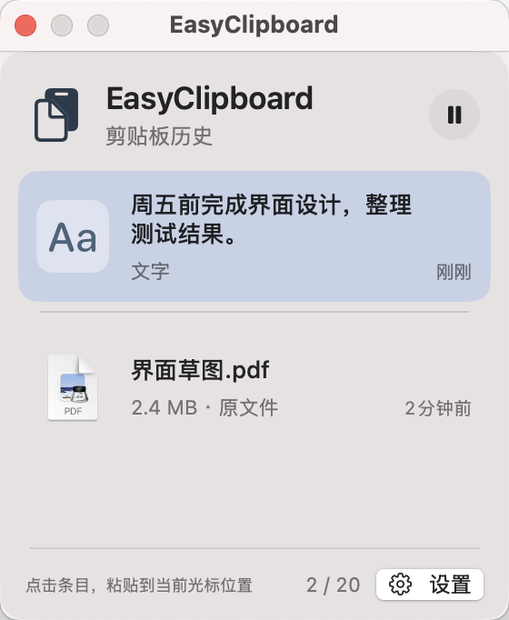
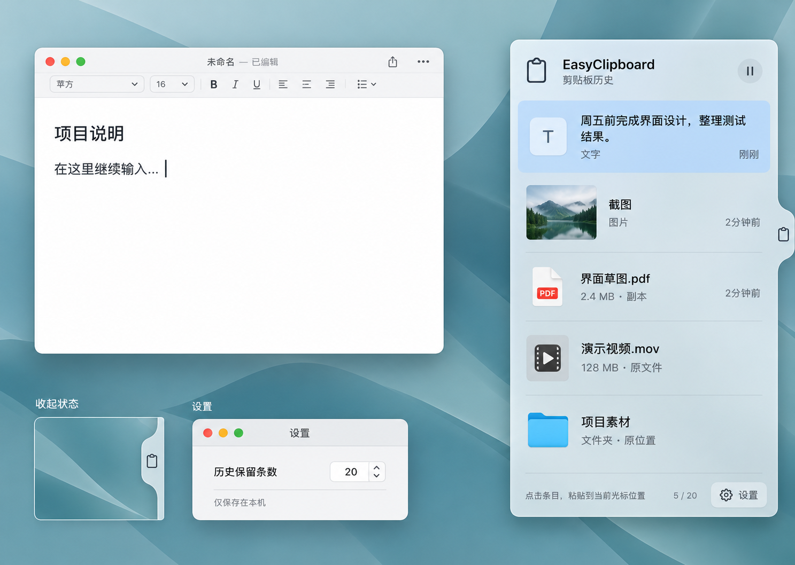

# EasyClipboard


轻量的原生 macOS 剪贴板历史工具，鼠标靠近屏幕右侧即可查看并粘贴最近复制的内容。

A lightweight native macOS clipboard manager. Move the pointer to the right edge of the screen to browse and paste recently copied content.

[中文](#中文) · [English](#english)

## 中文

### 功能

- 记录文字、图片和文件，重复内容自动移到顶部。
- 屏幕右侧悬浮面板，靠近展开、离开自动收起，保持目标应用的输入焦点。
- 默认保留最近 20 条，可调整数量、暂停记录、删除条目或清空历史。
- 所有历史与附件保存在本机，重启后仍可查看。
- 使用 SwiftUI、AppKit 和 Core Data，无第三方依赖。

### 运行与使用

需要 **macOS 15.5+、Xcode 16.4+**。克隆仓库并打开项目：

```sh
git clone https://github.com/jackma5477001/EasyClipboard.git
cd EasyClipboard
open EasyClipboard.xcodeproj
```

1. 在 Xcode 中选择 **EasyClipboard / My Mac**，点击运行。
2. 按 **⌘C** 复制文字、图片或文件。
3. 在目标应用中放好光标，将鼠标移到屏幕右侧中间的剪贴板标签附近，点击历史条目粘贴。
4. 自动粘贴需要在 **系统设置 → 隐私与安全性 → 辅助功能** 中允许 EasyClipboard。未授权时，点击条目恢复剪贴板后可手动按 **⌘V**。

应用常驻菜单栏，可从菜单打开历史、暂停记录或进入设置。

### 保存规则

小于 **10 MiB** 的普通文件保存副本；较大的文件、文件夹和符号链接引用原位置。原位置失效时会提示。历史与附件位于 `~/Library/Application Support/EasyClipboard/`，清理历史不会删除原文件。

## English

### Features

- Saves text, images, and files; duplicate items move to the top.
- A floating panel at the right edge opens on hover and collapses when the pointer leaves, preserving the target application's input focus.
- Keeps the latest 20 items by default, with an adjustable limit, pause/resume, item deletion, and history clearing.
- Stores history and attachments locally and restores them after relaunch.
- Built with SwiftUI, AppKit, and Core Data, with no third-party dependencies.

### Build and use

Requires **macOS 15.5+ and Xcode 16.4+**. Clone this repository and open `EasyClipboard.xcodeproj` using the commands above.

1. Select **EasyClipboard / My Mac** in Xcode and run the app.
2. Copy text, images, or files with **⌘C**.
3. Place the cursor in the target app, move the pointer near the clipboard tab at the middle of the right screen edge, and click a history item to paste.
4. Enable EasyClipboard under **System Settings → Privacy & Security → Accessibility** for automatic pasting. Without permission, clicking an item restores it to the clipboard so you can press **⌘V** manually.

The app stays in the menu bar, where you can open history, pause recording, and access settings.

### Storage

Regular files smaller than **10 MiB** are copied locally. Larger files, folders, and symbolic links reference their original locations; unavailable files are reported. History and attachments live in `~/Library/Application Support/EasyClipboard/`. Clearing history does not delete original files.

## 图片说明 / Images



**实际界面：** 隔离测试中的历史窗口，使用示例文字和文件记录展示蓝色选中态、暂停按钮、历史计数与设置入口。

**App screenshot:** The history window captured during an isolated UI test, using sample text and file entries to show the blue selection, pause button, history count, and settings.



**界面设计参考：** 右侧面板展示文字、图片和文件记录；左下为收起后的边缘标签，中下为历史条数设置。此图为设计参考，实际面板采用更紧凑的布局。

**Design reference:** The right panel shows text, image, and file history. The lower left shows the collapsed edge tab; the settings window adjusts the history limit. The implemented panel uses a more compact layout.

**应用图标：** 页首的蓝色剪贴板和叠放卡片代表复制内容与历史记录，图标原图及 AI 绘图提示词见 [图标生成说明](docs/图标生成说明.md)。

**App icon:** The blue clipboard and stacked cards at the top represent copied content and its history. See [icon creation notes](docs/图标生成说明.md) for the original artwork and AI prompts.

## 测试 / Tests

```sh
xcodebuild -project EasyClipboard.xcodeproj -scheme EasyClipboard \
  -configuration Debug -destination 'platform=macOS' \
  -derivedDataPath /private/tmp/EasyClipboard-validation \
  test CODE_SIGN_IDENTITY=-
```

测试使用独立存储和模拟剪贴板。详细验证记录见 [验收记录](docs/验收记录.md)。

Tests use isolated storage and a mock clipboard. See [validation notes](docs/验收记录.md) for details.
