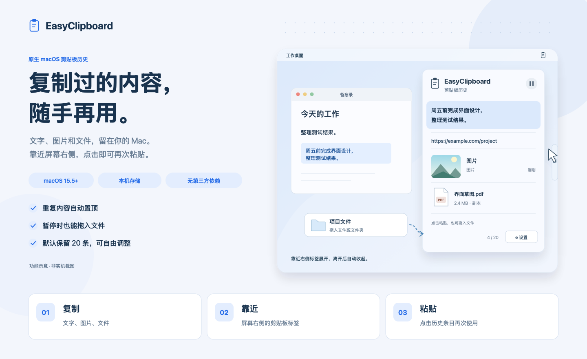

<div align="center">
  
  <h1>EasyClipboard</h1>
  <p><a href="README.md">English</a> · <strong>简体中文</strong></p>
  <p><strong>复制过的内容，随手再用。</strong></p>
  <p>轻量的 macOS 原生剪贴板历史工具，保存文字、图片和文件。</p>
  <p>macOS 15.5+ · SwiftUI + AppKit · 本机存储 · 无第三方依赖</p>
</div>



*中文功能示意图，采用蓝白浅色样式。应用当前使用中文界面和浅色面板。*

## 功能

- **记录文字、图片和文件。** 最近复制的内容集中保存，重复复制的内容自动移到顶部。
- **靠近屏幕边缘即可展开。** 鼠标靠近屏幕右侧中间的剪贴板标签时打开历史面板。面板垂直居中，少量记录时自动缩短，最高 480 点，较多内容可滚动查看；鼠标离开后短暂延迟收起。
- **点击条目即可粘贴。** 悬浮面板保持目标应用的输入焦点；授予辅助功能权限后，点击条目会恢复剪贴板并向目标应用发送 **⌘V**。
- **文字预览更清晰。** 只显示待粘贴原文，不添加类型图标或时间等信息。条目按内容自适应高度，最多预览 6 行，点击仍粘贴完整原文。
- **文件和文件夹可直接拖入。** 支持一次拖入一个或多个文件、文件夹，暂停自动记录时也可手动添加。
- **历史由你控制。** 默认保留最近 20 条，可调整数量、暂停或恢复记录、删除单条内容或清空历史。
- **重启后继续使用。** 历史通过 Core Data 保存在本机，图片与文件副本由附件存储管理。

## 构建与运行

需要 **macOS 15.5 或更新版本**及 **Xcode 16.4 或更新版本**。

```sh
git clone https://github.com/jackma5477001/EasyClipboard.git
cd EasyClipboard
open EasyClipboard.xcodeproj
```

在 Xcode 中选择 **EasyClipboard** 方案及 **My Mac** 运行目标，按 **⌘R** 启动。应用常驻菜单栏，点击剪贴板图标即可打开历史、暂停记录、进入设置或退出。

## 使用方法

1. 按 **⌘C** 复制文字、图片或文件。
2. 在目标应用中，将光标放到需要粘贴的位置。
3. 将鼠标移到屏幕右侧中间的剪贴板标签附近。
4. 点击历史条目，恢复内容并粘贴。

自动粘贴需要在 **系统设置 → 隐私与安全性 → 辅助功能** 中允许 EasyClipboard，也可从菜单栏选择「开启自动粘贴权限…」。未授权时，点击条目仍会恢复剪贴板，可手动按 **⌘V** 粘贴。如果粘贴前目标应用已切换，也会提示改用手动粘贴。

手动添加文件时，可从 Finder 将文件或文件夹拖入面板。拖入操作本身不会改写系统剪贴板，点击对应条目后才会恢复文件供粘贴。

鼠标悬停在条目上即可显示删除按钮，也可右键选择「删除」。点击齿轮按钮进入设置，将历史保留条数改为正整数，或清空历史。调低条数会立即移除最旧的超额记录。暂停期间复制的内容会被跳过，恢复记录后不会补录。

## 保存规则

历史和附件位于：

```text
~/Library/Application Support/EasyClipboard/
├── History.sqlite
└── Attachments/
```

| 内容 | 保存方式 |
| --- | --- |
| 文字 | 保存完整原文，包括空白 |
| 图片 | 保存本机 PNG 或 TIFF 数据 |
| 单个小于 **10 MiB** 的普通文件 | 保存本机副本；副本保存失败时保留原位置引用 |
| **10 MiB 及以上**的文件、文件夹、符号链接 | 引用原位置 |

引用原位置的文件被移动或删除后可能无法使用，应用会提示失效内容，不会只粘贴多文件记录中的部分文件。删除历史时会清理不再使用的应用附件，但会保留系统剪贴板仍在引用的副本。清理历史不会删除原文件。

## 开发与测试

使用 **Swift、SwiftUI、AppKit 和 Core Data**，仅依赖系统框架，无第三方依赖。

| 源文件 | 职责 |
| --- | --- |
| `ClipboardController.swift` | 记录、去重、容量限制、暂停与恢复 |
| `ContentView.swift` | 历史条目、拖入文件与设置 |
| `FloatingPanelCoordinator.swift` | 边缘标签、面板布局与悬停交互 |
| `PasteCoordinator.swift` | 目标应用与粘贴权限 |
| `AttachmentManager.swift` | 文件副本、原位置引用与附件清理 |
| `Persistence.swift` | Core Data 存储与迁移 |

运行单元测试：

```sh
xcodebuild -project EasyClipboard.xcodeproj -scheme EasyClipboard \
  -configuration Debug -destination 'platform=macOS' \
  -derivedDataPath /private/tmp/EasyClipboard-tests \
  -only-testing:EasyClipboardTests test CODE_SIGN_IDENTITY=-
```

去掉 `-only-testing:EasyClipboardTests` 即可同时运行 UI 测试。UI 测试需要可启用 Xcode UI 自动化的交互式 macOS 会话。测试使用独立存储与模拟剪贴板，粘贴事件通过注入接口验证。

测试完成后删除临时构建缓存：

```sh
rm -rf /private/tmp/EasyClipboard-tests
```

已有[验收记录](docs/验收记录.md)列出了已完成验证和待实机检查项目。README 配图保留了可编辑的 SVG 源文件：[中文](docs/images/overview.zh-CN.svg)与[英文](docs/images/overview.en.svg)。
